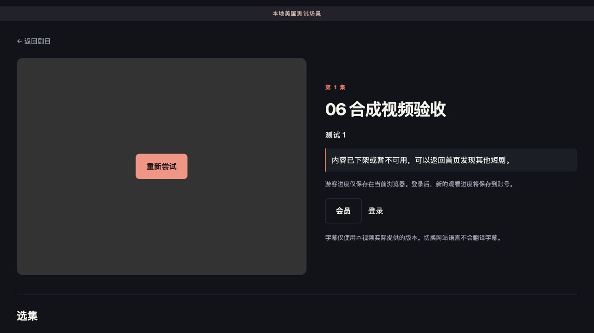

# 06 真实浏览器方法与证据

业务共同起点为 4f1c3097a38309e88c9bea5dcb1b6992f9f007d3；最终复验 checkout 为 **88c2feff53b3f962ab85bc4a3799463754d54759**，契约1.0.3。这里记录真实浏览器解码，不替代真机/自然无原生HLS浏览器或人工视听。

## 运行边界

- App：127.0.0.1:8206；代理：127.0.0.1:8207，后者只在测试期间运行。它转发真实 HTTP、只改本机 origin 并注入观察脚本，不制造成功授权，不签名媒体链接，不改应用代码。
- 内容：06自行用FFmpeg生成140秒H.264/AAC，经过真实Content导入/处理/发布，六个分集共用同一个测试视频。不是从02/04拷来的素材。
- 浏览器：Codex内置Chromium154。原始 `canPlayType` 为 maybe，`force-mse.js` 只令 application/vnd.apple.mpegurl 返回空，触发应用的非原生分支。hls.js 1.7.3、MediaSource、解码器、网络、日期/计时器、授权响应均真实。
- `observer.js`只写一个可见指标区，读取真实播放状态；`hls-monitor.js`继承真实Hls捕获错误码，不替换请求或成功事件。工具文件摘要在manifest中。
- 未使用04状态替身作为真实解码证据。16项状态测试另附player-state.txt。

## 本次实际操作

1. 设置 `.runtime/06/network-mode` 为 normal，建立空文件 `.runtime/06/force-mse`，运行 `python3 scripts/ops/browser_proxy.py`。
2. 打开自己的 `/dramas/{drama}/episodes/{episode}?position=0`，点击“播放本集”。`mse.json`显示实际非原生blob源、尺寸320×180、readyState4、暂停为false、真实时间和已解码帧。
3. 播放期间把 mode 改为 reset。代理直接关闭许可和媒体TCP连接；不是改 navigator.onLine 或人工派发offline事件。`network-failed.json`捕获多个fragLoadError及最后fatal、清除src、readyState0/paused=true。
4. 改回normal，点击前保存 `network-no-auto.json`，确认未自行续播；点击“重新尝试”后 `network-retry.json`显示重新获取许可及实际解码恢复。错误列表保留当前页面历史，之前fatal不代表重试后仍失败；以当前帧、时间、暂停及状态判断。
5. 重新从0播放，临近续签时由 `php scripts/ops/local_preview.php withdraw` 通过Content真实服务下架自己的剧；旧分片409，续签拒绝，`permission-denied.json`和截图显示下架/暂停/src清空。再次重试仍拒绝。完成后 `relist` 恢复自己的样例，不执行故障补发。
6. 停止8207代理，用户入口恢复为原始8206；未改变Mac网络或其他工作区。

## 判读

`currentSrc`在Chromium加载清理后仍可能短暂保留旧blob字符串，因此同时看 `srcAttributePresent=false`、readyState0、paused=true、尺寸0及错误提示。不能仅以页面有video节点或HTTP200判定真实播放。

图片是页面状态凭证；时间与解码帧是底层播放证据。当前截图未用于证明真实短剧视听质量、所有字幕同步或手机全屏行为。真实iPhone Safari、Android Chrome、手机网络切换、支付跳转和自然无原生支持桌面浏览器，均待外部条件完成。

## 最终固定提交的采样值

| 采样 | UTC | 结果 |
|---|---|---|
| mse | 2026-10-07T11:03:16.230Z | 时间31.39s，帧758，paused=False，src属性=True；正在播放 |
| network-failed | 2026-10-07T11:05:27.231Z | 时间0s，帧0，paused=True，src属性=False；视频加载失败，请重试以重新核对权限并加载。 |
| network-no-auto | 2026-10-07T11:05:54.230Z | 时间0s，帧0，paused=True，src属性=False；视频加载失败，请重试以重新核对权限并加载。 |
| network-retry | 2026-10-07T11:06:39.730Z | 时间128.27s，帧1066，paused=False，src属性=True；正在播放 |
| permission-denied | 2026-10-07T11:10:13.979Z | 时间0s，帧0，paused=True，src属性=False；内容已下架或暂不可用，可以返回首页发现其他短剧。 |
| permission-retry | 2026-10-07T11:10:44.977Z | 时间0s，帧0，paused=True，src属性=False；内容已下架或暂不可用，可以返回首页发现其他短剧。 |

