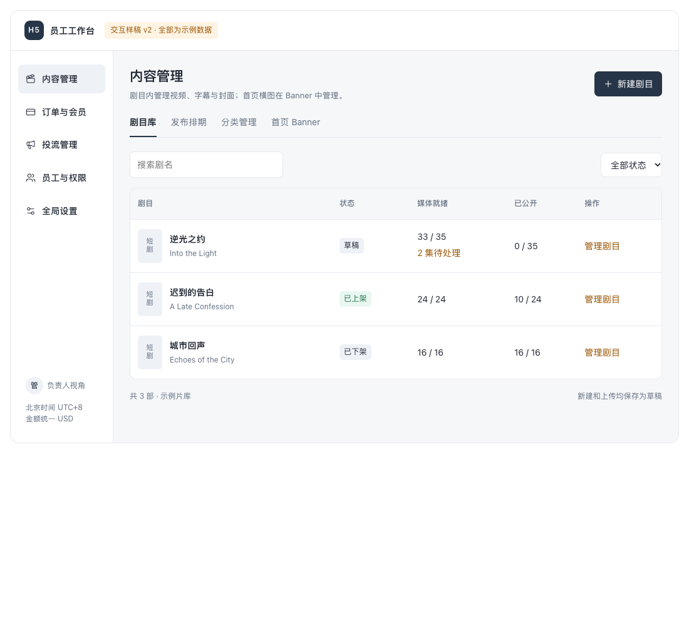
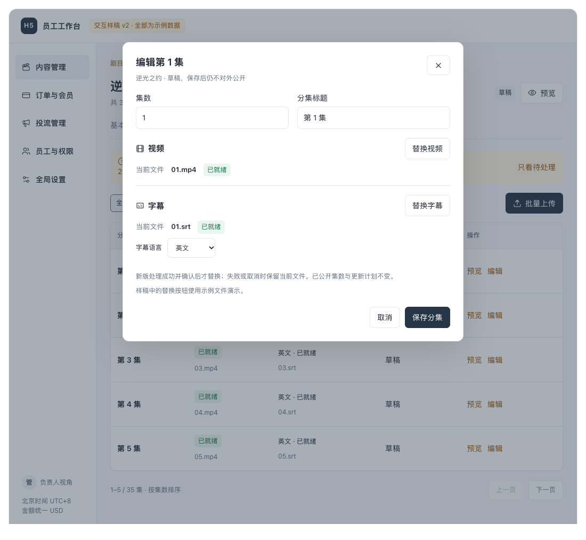
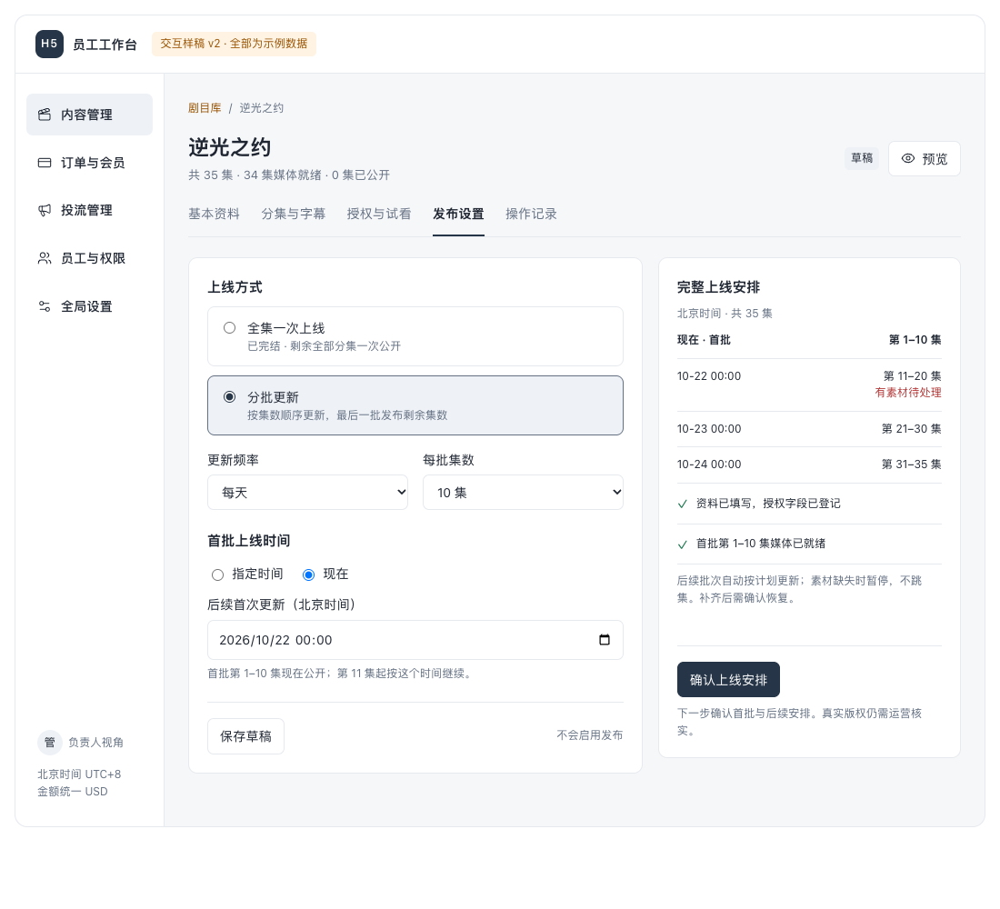
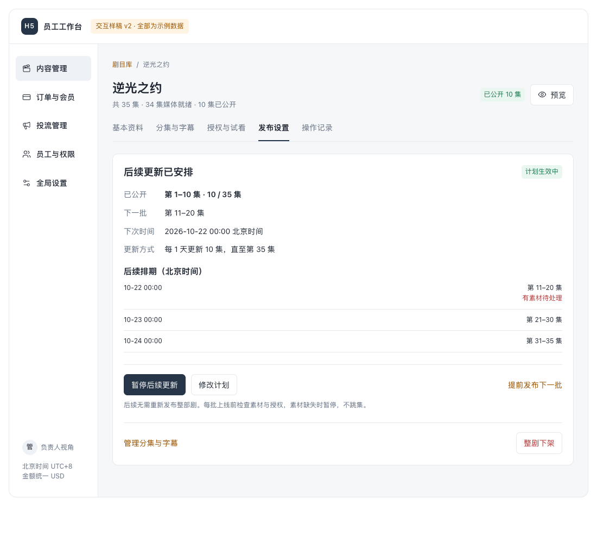

# 08 员工后台 UI v2：用户确认归档

2026-10-21，用户在「08 员工后台体验与交互改版」确认：

> OK 我觉得这版的ui行了，记得在github上面存档。然后发送给对应的子任务进行相应的工作

这份归档固定本轮获批的界面和交互，供既有模块任务实施、00 集成、06 复验。原型仍是示例数据，不是实际后台，也不代表生产上线或官方支付通过。

## 怎样查看

- 下载本目录后，用浏览器打开 `index.html`，顶部显示「交互样稿 v2」。在 GitHub 的文件页只能查看源码，不能直接操作页面。
- 进入「剧目库 → 逆光之约 → 管理剧目」。在「分集与字幕 → 编辑」体验独立替换视频与字幕；在「发布设置」选择「分批更新 → 现在」，查看首批与后续排期。
- 完整演示上线：分集页选择「批量上传 → 选择示例视频 → 开始模拟上传」，补齐样稿内第 8、12 集的问题。此操作不读取或上传真实文件。
- `approved-fragment.html` 是用户确认的原型原始片段；`index.html` 只增加独立浏览器所需的外壳。图标依赖公开 CDN，主要界面与交互无需业务服务。
- 示例总集数 35、日期 2026-10-21/22、演示价格及剧名不是业务默认值；正式实现使用真实数据和实际北京时间。

## 确认的改版范围

| 范围 | 本轮确认 |
|---|---|
| 员工后台结构 | 按模块和子标签切换，一次展示一个功能区；新增、编辑等操作就近打开，不把各功能表单堆成长页 |
| 内容一级标签 | 剧目库、发布排期、分类管理、首页 Banner；移除独立素材库入口 |
| 剧目详情 | 基本资料、分集与字幕、授权与试看、发布设置、操作记录；视频/SRT 在分集内，封面在基本资料，Banner 横图在对应 Banner 内管理 |
| 分集替换 | 已就绪、草稿和已公开分集都有独立的视频及字幕替换入口；显示当前文件与候选文件，处理成功并确认后应用；失败或取消保留原文件；公开集数、免费范围和更新计划不随替换改变 |
| 发布 | 统一为「全集一次上线 / 分批更新」与「指定时间 / 现在」。首批现在发布时，一并确认剩余集数的更新计划；生效后显示已公开、下一批、下次时间和后续排期 |
| 手动发布 | 保留既有手动/批量能力。正常流程中不再单列一套立即发布向导；计划生效后可辅助「提前发布下一批」，同步下一未公开集数并说明对后续安排的影响 |
| 密码 | 员工后台密码下限从 12 位改为 8 位；保留字母和数字、上限、二次验证及既有权限保护 |
| 金额 | 员工输入与展示使用美元 USD，最多两位小数；后台金额整数和支付契约仍使用最小货币单位，不能把 12 美元误存为 12 美分 |

详细边界、兼容说明和验收场景见 [实施说明](implementation.md)。

## 核心画面

## 实施分工

| 负责人 | 本轮工作 | 交付要求 |
|---|---|---|
| 00 | 确认共享员工后台布局及样式归属、必要公共组件/契约；接收本归档，更新总台账；串行集成、回传缺陷 | 冻结共享接口和集成候选，提供一个真实可用入口；不把原型当应用代码合入 |
| 01 | 员工账号/审计分栏、员工创建编辑；员工/负责人密码下限 8 位与所有相关入口校验一致 | Identity 范围固定提交、边界测试和员工操作说明 |
| 02 | 内容四个一级标签、单剧五个子标签；就近素材管理与安全替换；统一发布和后续更新；全局免费配置仍按既有权限 | Content 固定提交、媒体/发布/权限测试、实际浏览器证据 |
| 03 | 订单查询、会员价格、客服记录分栏；所有账务金额以美元输入/展示并正确转换 | 不改账本事实和订阅价格规则；覆盖小数/边界/新旧订阅回归 |
| 05 | 现有投流后台按推广链接、像素资产、付款汇总、发送记录分栏；金额统一 USD | 仅现有本地/受控功能，不启动 D05、网站来源衔接或真实外发 |
| 06 | 先准备针对本次变化的验收，再对 00 指定的同一候选做真实浏览器及必要组合复验 | 原型检查与应用验收分开；不得用旧报告证明新版本通过 |

04 本轮不新开观众网站改版；若内容或金额联动出现明确消费者问题，由 00 按既有分工回传。07 的外部申请工作不因本轮 UI 获批而自动放行。

## 归档证据与范围

- 原型交互检查：32 项通过，清单见 `prototype-checks.json`；这些是原型检查，不能作为 Laravel 后台、数据库、媒体或支付验收。
- 原型、独立预览、截图和检查结果的 SHA-256 见 `manifest.json`。
- 本次应用依托基线：`15bd8fa204fa7cd499702ede826e727768bcd58b`；既有应用接收提交 `a25dd8f`；公共契约 `1.0.4`。
- 本归档没有真实密钥、账号口令、视频、字幕原文件、数据库或 `.env`；只包含示例 UI 及交接材料。
- 不修改旧标签，不覆盖主工作区。模块保留自己的已有变更，普通合并 00 指定的当前基线后实施。

## 设计参考

这些是上一轮调研使用的公开项目链接，供理解列表、详情、标签和编辑流程；本轮没有引入这些项目的依赖或复制它们的产品规则。

- [Filament](https://github.com/filamentphp/filament)：后台列表、编辑表单和标签组织。
- [Strapi](https://github.com/strapi/strapi)：内容详情和草稿/发布状态的区分。
- [Directus](https://github.com/directus/directus)：上下文中的文件关联与管理；本项目不照搬独立素材库导航。
- [PeerTube](https://github.com/Chocobozzz/PeerTube)：视频、字幕、处理状态与公开状态的区分。
